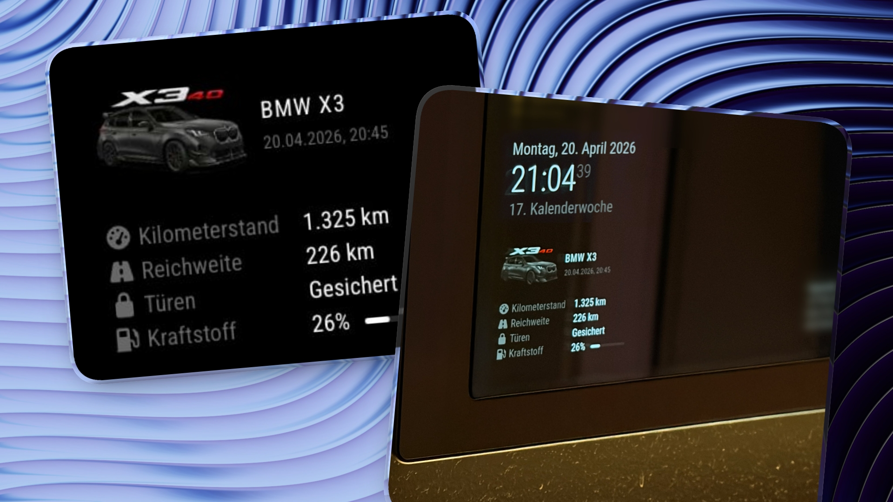

# MMM-BMWCD

A [MagicMirror²](https://magicmirror.builders) module for [BMW CarData Gateway](https://github.com/wiesty/bmw-cardata-gateway). Supports ICE, BEV and PHEV vehicles, multiple module instances and the older `bmw-cardata-bridge` API.



## Display

Available values are shown automatically; unsupported values are omitted:

- Mileage, total range, electric range and fuel range
- Fuel percentage and volume; battery charge, charge target and charging power/status
- Lock status, individual doors, hood, trunk, windows and alarm system
- Preconditioning, engine, ignition, lights, 12 V battery voltage and coolant temperature
- Tyre pressure for each wheel, with target pressures when available
- Service messages, including status, remaining distance and due date
- Vehicle details in the full view: model, series, engine, production date, colour and equipment
- Optional location, altitude and heading
- Optional list of **all populated telemetry descriptors**, with BMW units and source timestamps in the full view

### Four views

Set `view` to choose the display:

| View | Display |
|------|---------|
| `"ultra"` | Original compact layout: image beside name and full date, followed by mileage, range, locks and fuel/battery rows |
| `"minimal"` (default) | Mileage, range, battery/fuel and a combined closure/lock status |
| `"service"` | Minimal view plus the next service, with further service messages in a scrolling line |
| `"full"` | All available individual fields, service entries and vehicle details |

The module uses MagicMirror's fonts and its `medium`, `small` and `xsmall` size classes. It has no widget background, card border or extra padding. Green indicates a complete, closed and locked vehicle; red indicates an open opening or unlocked vehicle. Incomplete readings stay neutral. No touch interaction is required to read service entries or details.

Drive-specific fields are automatic, as in the original module. ICE vehicles show fuel, BEVs show battery and charging information, and PHEVs show both when BMW supplies them. All views retain distinct electric/fuel ranges when they differ from the main range. An active charging session and plug state are also visible in compact views; absent fields are omitted and zero values are preserved. The ultra view omits services and vehicle details, uses the original small table typography and keeps the fuel value without a bar.

Service messages are prioritised by status (overdue, pending, other, OK). Standard BMW service titles have translated short names. The scrolling line honours reduced-motion preferences, and can also be paused with hover or keyboard focus.

The header uses the newest timestamp from `telematic_data` when available. Hover over it for the gateway's poll time. With older bridges it shows the poll time instead. The newest reading does not imply every value is equally recent; enable `showTelematics` to inspect individual timestamps.

Connection errors keep the last successfully received data on screen with a notice. Missing lock states appear as unknown. Both `SECURED` and `LOCKED` are recognised. Partial tyre readings show a dash for missing wheels.

Updates do not fade the module out and in. Unchanged responses leave the DOM in place, preserving the service scroll position.

## Installation

```bash
cd ~/MagicMirror/modules
git clone https://github.com/wiesty/MMM-BMWCD.git
```

The generated JavaScript files are included. Normal installation does not require npm or a TypeScript build.

## Configuration

Add this to `config/config.js`:

```js
{
    module: "MMM-BMWCD",
    position: "top_left",
    config: {
        view: "service",
        bridgeUrl: "http://192.168.1.1:8080",
        // vehicleName: "My BMW", // otherwise uses basic_data.modelName
        // vehicleImage: "car.png",
        // apiKey: "your-gateway-api-key",
    }
}
```

For a gateway tracking multiple vehicles, specify `vin`. Add another module instance to display another vehicle:

```js
config: {
    bridgeUrl: "http://192.168.1.1:8080",
    vin: "WBA12345678901234",
    vehicleName: "My BMW",
    showTireTargets: true,
    hiddenFields: ["ignition", "engine", "lights"],
}
```

The module requests `/vehicle` or `/vehicle/{vin}` from the gateway. It never calls BMW directly. Refreshing the mirror only reads the gateway cache; configure BMW polling in the gateway itself.

| Option | Default | Description |
|--------|---------|-------------|
| `view` | `"minimal"` | `"ultra"`, `"minimal"`, `"service"` or `"full"` |
| `bridgeUrl` | `"http://192.168.1.1:8080"` | Base URL of the gateway; trailing slashes are accepted |
| `vin` | `null` | Required for gateways tracking multiple vehicles |
| `vehicleName` | `null` | Custom title; otherwise BMW model name, falling back to `My BMW` |
| `vehicleImage` | `null` | Module-relative image filename, server URL path or HTTP(S) URL |
| `imageHeight` | `220` | Maximum image height in pixels. Smaller values shrink the image; its proportions are preserved and its width stays within the module |
| `apiKey` | `null` | Sent in the `X-API-Key` header if the gateway requires authentication |
| `updateInterval` | `60000` | Delay in ms between gateway requests; minimum 1000 ms |
| `requestTimeout` | `10000` | Abort a stalled request after this many ms |
| `animationSpeed` | `0` | Legacy option; refreshes always use zero transition time |
| `hiddenFields` | `[]` | Field groups to hide; see below |
| `showTireTargets` | `true` | Show actual / target pressures in bar |
| `showLocation` | `false` | Show GPS coordinates, altitude and heading |
| `showTelematics` | `false` | Show all raw readings in the full view; this also includes location descriptors supplied by BMW |
| `serviceScrollDuration` | `90` | Seconds per complete service scroll cycle |

Requests are serial, time out and pause when the module is suspended. Authentication, VIN selection, startup and response errors have separate messages.

### Field groups

Use these keys in `hiddenFields`:

| Key | Display |
|-----|---------|
| `mileage` | Mileage |
| `range` | Total / best available range |
| `range_electric` | Electric range when different from the main range |
| `range_fuel` | Fuel range when different from the main range |
| `doors` | Lock status |
| `security` | Combined closure/lock status in all views |
| `openings` | Individual doors and overall door status |
| `trunk`, `hood`, `windows` | Body openings |
| `alarm` | Alarm armed and triggered states |
| `battery`, `battery_target` | Charge level and target |
| `fuel`, `fuel_liters` | Fuel percentage and volume |
| `plug`, `charging`, `charging_power` | Charging information |
| `climate` | Preconditioning and remaining time |
| `tires`, `tire_diagnosis` | Pressures / targets and diagnosis |
| `battery_voltage`, `coolant` | Battery voltage and coolant temperature |
| `moving`, `ignition`, `engine`, `lights` | Operating states |
| `service` | Service messages and next service distance |
| `check_control` | Check Control messages |
| `location` | Coordinates, altitude and heading (also requires `showLocation`) |
| `vehicle_details` | Vehicle metadata in full view |

Service dates and CBS distance units are preserved; numeric distances use the display locale. BMW's `unitOfLengthRemaining` uses the vehicle's configured distance unit; the module does not label it as km. Coolant readings retain the source unit if available. A value that BMW does not supply remains absent. Location and raw telemetry require the full view as well as their respective show options.

## Vehicle images

Set `vehicleImage` to display a large image above the title and metrics, or a compact image beside the title in the ultra view. Place your image in this module's folder and set `vehicleImage: "car.png"`. Paths such as `"/images/car.png"` refer to files served by the MagicMirror web server, rather than arbitrary filesystem paths. HTTP(S) image URLs are also supported. Broken images are hidden.

Use `imageHeight: 160` for a smaller image, or `imageHeight: 220` for the default limit. Each module instance can use its own value. The image fits the available width without cropping or stretching. Non-positive or invalid heights fall back to the default limit.

## Languages

German, English, French, Spanish, Italian, Dutch, Polish and Portuguese are included. The module uses MagicMirror's language for labels, dates and numbers, with English as the translation fallback. BMW-supplied text is preserved in its original language.

## Requirements

- MagicMirror² v2.x with its bundled Font Awesome icons
- A reachable BMW CarData Gateway (v1.2.0 for expanded data) or older `bmw-cardata-bridge`
- Gateway CORS settings allowing the MagicMirror browser origin; an HTTPS mirror requires an HTTPS gateway URL

The API key is used in the MagicMirror frontend, so mirror clients can access it. It is a gateway key, not a BMW OAuth credential.

## Development

Source files are in `src/`. `MMM-BMWCD.js` and `lib/*.js` are generated browser scripts and must be included when distributing changes. The module uses MagicMirror's DOM and scoped stylesheet conventions, without a separate application framework.

Requires Node.js 24.15.0 or newer for the development tests:

```bash
npm ci
npm run typecheck
npm test
```

`npm test` compiles the TypeScript and runs Node tests with jsdom. Tests cover legacy and expanded data, safe text rendering, partial responses, authentication errors, timeouts and suspension. No browser or live BMW access is needed. Test fixtures contain synthetic values only.

## License

[Apache 2.0](LICENSE). This project is not affiliated with or endorsed by BMW Group.
